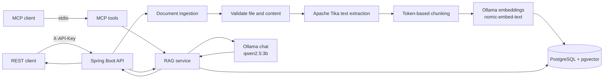

# Document Intelligence

> A local document Q&A service that extracts text, indexes it in pgvector, and returns answers grounded in uploaded files.

[](https://www.oracle.com/java/)
[](https://spring.io/projects/spring-boot)

Document Intelligence provides a REST API and MCP server for uploading documents, searching their contents, and asking questions with retrieval-augmented generation (RAG). Text extraction, embeddings, vector search, and chat inference are configured to run with local services.

## Features

- Upload PDF, DOCX, and TXT files up to 10 MB.
- Extract text with Apache Tika and split it into searchable chunks.
- Generate embeddings with Ollama and store chunks in PostgreSQL with pgvector.
- Search the top five semantically similar chunks.
- Ask questions answered from retrieved document text, with source filenames and chunk references.
- Expose document search and Q&A as MCP tools.
- Protect REST endpoints with an `X-API-Key` header.

## Architecture



### Request flow

1. The upload endpoint checks the filename, extension, file size, and detected content type.
2. Apache Tika extracts text. The chunking service creates chunks with source filename and document ID metadata.
3. Spring AI creates embeddings through Ollama and stores the chunks in the pgvector store.
4. Search retrieves up to five similar chunks. Ask sends those chunks and the question to the configured Ollama chat model, with instructions to answer only from the supplied context.
5. The response includes the retrieved source chunks for inspection.

Uploads are processed synchronously by the API request. This repository does not include a browser UI, queue, or original-file storage service.

## Screenshots

This repository is a backend service and does not currently include a graphical interface or screenshot assets. Use the architecture diagram above to see the service flow.

## Requirements

- Java 21
- Docker with Docker Compose (for the provided PostgreSQL + pgvector service)
- Ollama running locally, with the configured chat and embedding models downloaded
- macOS, Linux, or Windows with WSL for the shell examples below

## Frontend UI Chatbox

A modern, responsive, and dark-themed web chat interface is bundled directly in `src/main/resources/static/` and served automatically by Spring Boot at root: `http://localhost:8080/`.

Features:
- **Interactive Chatbox**: Ask questions with full markdown rendering and conversation history.
- **Edit & Resubmit**: Edit previously sent user prompts inline and regenerate responses.
- **Copy Message**: One-click copy for user questions, assistant answers, and search results with toast notifications.
- **Stop & Retry**: Cancel generation in-flight with the **Stop** button, and re-trigger queries on stopped, errored, or completed answers with the **Retry** action.
- **RAG & Search Toggle**: Switch seamlessly between full AI question answering (`/api/documents/ask`) and semantic chunk search (`/api/documents/search`).
- **Drag-and-Drop Ingestion**: Upload PDF, DOCX, or TXT documents right from the sidebar with instant progress feedback and indexed chunk counters.
- **Source Chunk Inspector**: Click on any retrieved source pill to view its chunk ID, origin file, and exact context text in a dedicated modal.

## Setup

### 1. Clone the repository

```bash
git clone https://github.com/Tamilarasan-mac/document-intelligence.git
cd document-intelligence
```

### 2. Start PostgreSQL with pgvector

```bash
docker compose up -d postgres
```

Compose creates a local database named `document_db` on port `5432`. The development credentials are `document_user` / `document_password`; change them before using this setup beyond local development.

### 3. Install and prepare Ollama models

Install and start Ollama using the instructions for your operating system at [ollama.com](https://ollama.com/download). Then pull the models configured in `src/main/resources/application.yml`:

```bash
ollama pull qwen2.5:3b
ollama pull nomic-embed-text
```

The service expects Ollama at `http://localhost:11434` by default.

### 4. Configure API authentication

The REST API returns `503 Service Unavailable` when no API key is configured. Set a non-empty key in the environment before starting the app:

```bash
export DOCUMENT_API_KEY="replace-with-a-long-random-local-secret"
```

Use your shell's equivalent environment-variable syntax on Windows. Keep the real key out of source control and request logs.

### 5. Run the application

macOS/Linux:

```bash
./mvnw spring-boot:run
```

Windows:

```powershell
.\mvnw.cmd spring-boot:run
```

The API listens at `http://localhost:8080`. The PostgreSQL vector-store schema is initialized by Spring AI on startup.

## Configuration

The defaults are in [`application.yml`](src/main/resources/application.yml).

| Setting | Default | Purpose |
|---|---|---|
| `DOCUMENT_API_KEY` | unset | API key required in the `X-API-Key` request header |
| PostgreSQL URL | `jdbc:postgresql://localhost:5432/document_db` | pgvector database connection |
| PostgreSQL username | `document_user` | Database user |
| PostgreSQL password | `document_password` | Local Compose database password; change for other environments |
| Ollama URL | `http://localhost:11434` | Chat and embedding model service |
| Chat model | `qwen2.5:3b` | Generates answers from retrieved chunks |
| Embedding model | `nomic-embed-text` | Embeds document chunks and search queries |
| Upload limit | `10MB` | Maximum multipart request and document size |

Database and Ollama settings are currently defined directly in `application.yml`; configure external service values there or update the application to use environment-variable overrides for deployment.

## REST API

Base URL: `http://localhost:8080/api/documents`

All `/api/` routes require the configured API key:

```http
X-API-Key: <your-api-key>
```

### Upload a document

```bash
curl --request POST \
  --url http://localhost:8080/api/documents/upload \
  --header "X-API-Key: $DOCUMENT_API_KEY" \
  --header "Accept: application/json" \
  --form "file=@./sample.pdf"
```

Supported filename extensions are `.pdf`, `.docx`, and `.txt`. The endpoint validates that the detected file content matches its extension and rejects empty files and files over 10 MB.

Example response (`201 Created`):

```json
{
  "documentId": "2e4dc020-b6a3-45c7-b2aa-e29cda56a973",
  "filename": "sample.pdf",
  "totalChunks": 4,
  "message": "Document uploaded and indexed successfully"
}
```

### Search indexed documents

```bash
curl --request POST \
  --url http://localhost:8080/api/documents/search \
  --header "X-API-Key: $DOCUMENT_API_KEY" \
  --header "Content-Type: application/json" \
  --data '{"question":"What is the payment due date?"}'
```

The endpoint returns up to five matching chunks:

```json
[
  {
    "chunkId": "a-chunk-id",
    "source": "sample.pdf",
    "content": "Payment is due within 30 days of the invoice date."
  }
]
```

### Ask a question

```bash
curl --request POST \
  --url http://localhost:8080/api/documents/ask \
  --header "X-API-Key: $DOCUMENT_API_KEY" \
  --header "Content-Type: application/json" \
  --data '{"question":"What is the payment due date?"}'
```

Example response:

```json
{
  "question": "What is the payment due date?",
  "answer": "The payment is due within 30 days of the invoice date. (Source: sample.pdf)",
  "sources": [
    {
      "chunkId": "a-chunk-id",
      "filename": "sample.pdf",
      "content": "Payment is due within 30 days of the invoice date."
    }
  ]
}
```

The answer is generated from the retrieved context. The `sources` array contains the retrieved chunks; check those passages when validating an answer.

### Responses and errors

| Status | Meaning |
|---:|---|
| `200` | Search or question request completed |
| `201` | Document extracted and indexed |
| `400` | Invalid question, unsupported or mismatched file, empty document, or document over the size limit |
| `401` | `X-API-Key` is missing or invalid |
| `503` | `DOCUMENT_API_KEY` is not configured |
| `500` | Document processing failed |

Error responses use a JSON `error` field. For example: `{ "error": "Only PDF, DOCX and TXT files are supported" }`.

## MCP server

The application also declares an MCP server with two tools:

- `search_documents(question)` returns relevant text passages and their source filenames.
- `ask_documents(question)` returns a generated answer and source references.

The server is configured for stdio transport in `application.yml`. MCP clients launch the Spring application as a local process and communicate over stdin/stdout. The repository's Logback configuration sends logs to stderr so stdout remains available to the MCP transport. The host must also be able to reach PostgreSQL and Ollama.

## Development

Run the test suite:

```bash
./mvnw test
```

The tests cover document ingestion validation, chunking behavior, and RAG service behavior. Build the application package with:

```bash
./mvnw package
```

## Security notes

- The API key filter protects all paths beginning with `/api/`; keep `DOCUMENT_API_KEY` private.
- The Compose database credentials are intended for local development and are not production secrets.
- Uploaded files are parsed and indexed; the application does not persist the original file as an object. Extracted chunks and metadata remain in PostgreSQL until deleted from the vector store/database.
- RAG answers can be wrong. Review the returned source passages for important decisions.

## License

No `LICENSE` file is present in the repository at the time this README was prepared. Add the intended license before describing the project as open source or adding a license badge.
